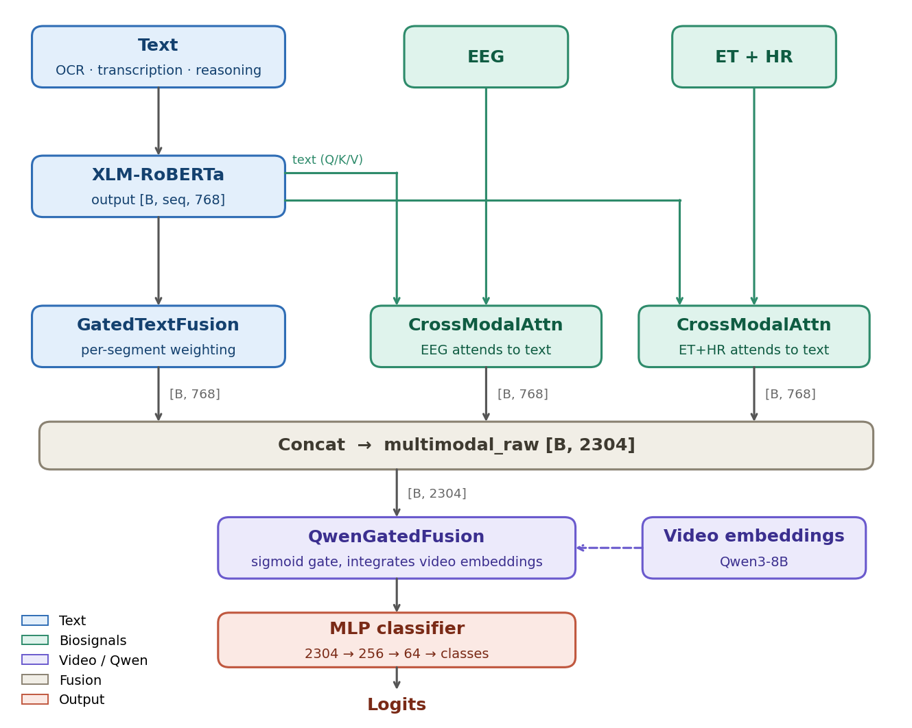
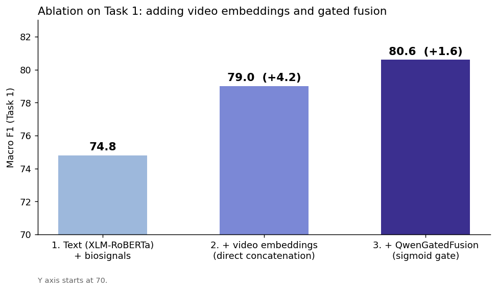
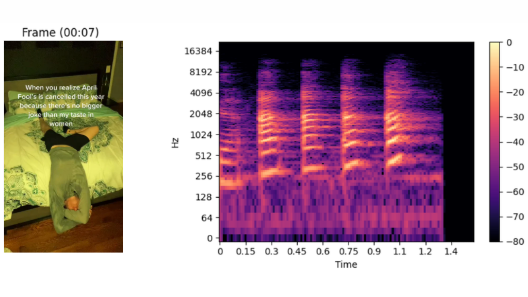

# Multimodal Sexism Detection in TikTok Videos

Developed together with [Miquel Gómez Corral](https://github.com/MiquelGomezCorral).

A multimodal classifier for the **EXIST 2026 Lab** (sEXism Identification in Social neTworks) video task. It fuses text from the video (OCR, speech transcription, reasoning from a vision-language model), physiological annotator signals (EEG, eye tracking, heart rate) and video embeddings, and is trained on soft labels (the distribution of annotator votes) instead of hard labels.

Detecting sexism in short videos matters for content moderation: the signal is spread across on-screen text, speech, and imagery, so a text-only classifier can miss part of it.

**Macro F1 of 80.7 / 68.4 / 52.5 on EXIST 2026 Tasks 1 / 2 / 3** (binary, 3-class, 6-label multilabel).

**Stack:**    

<p align="center">
  
  <br><em>Architecture: text, EEG and eye-tracking/heart-rate branches are fused, then gated with Qwen3-8B video embeddings before the MLP classifier.</em>
</p>

## Approach

What each modality contributes: text (OCR, transcription, VLM reasoning) is the backbone representation; EEG and eye-tracking/heart-rate signals from annotators attend to that text to add a physiological view; Qwen3-8B video embeddings add visual content through a gate.

- **Text encoder:** XLM-RoBERTa over OCR text, transcription and Qwen reasoning, with a gated fusion across text segments (`GatedTextFusion`).
- **Biosignals:** two cross-modal attention branches (EEG; eye tracking + heart rate) that attend to the text representation.
- **Video:** Qwen3-VL 8B embeddings, integrated with a sigmoid-gated fusion (`QwenGatedFusion`).
- **Loss:** KL divergence against the annotator vote distribution (`SoftLabelLoss`).
- **Training:** two phases. First the backbone is frozen (gate, branches and classifier only), then full fine-tuning with layer-wise discriminative learning rates. Text dropout, early stopping and cosine annealing are used.
- **Data:** about 2,500 videos with multi-subject physiological annotations.

## Results

Macro F1 and soft-label cross-entropy (CE) per task and variant. The numbers come from the project's evaluation as presented by the authors; whether they were measured on the official test set or a development split is not stated here. Task 1 is binary, Task 2 has 3 classes and Task 3 is 6-label multilabel (see `app/scripts/run.sh`).

| Task | Variant | Macro F1 | CE (soft labels) |
|---|---|---|---|
| 1 (binary) | **Full model (with annot.)** | **80.7** | 0.5112 |
| | Full model (without annot.) | 80.6 | 0.5049 |
| | No biosignals | 79.9 | 0.5083 |
| 2 (3 classes) | **Full model (with annot.)** | **68.4** | 0.7533 |
| | Full model (without annot.) | 68.3 | 0.7462 |
| | No biosignals | 67.9 | 0.7887 |
| 3 (6-label) | **Full model (with annot.)** | **52.5** | n/a |
| | Full model (without annot.) | 51.0 | n/a |
| | No biosignals | 51.8 | n/a |

Removing the biosignals costs between 0.5 and 0.8 F1 points (Task 1: -0.8, Task 2: -0.5, Task 3: -0.7), so they add a small but consistent gain on top of text and video.

### Ablation (Task 1)

<p align="center">
  
  <br><em>Video embeddings give the largest single gain (+4.2 F1); the sigmoid gate adds a further +1.6. The final bar (80.6) matches the "Full model (without annot.)" row for Task 1 above; the 80.7 headline is the with-annotations variant.</em>
</p>

| Step | Configuration | Macro F1 | Delta F1 |
|---|---|---|---|
| 1 | Text (XLM-RoBERTa) + biosignals | 74.8 | n/a |
| 2 | + video embeddings (direct concatenation) | 79.0 | +4.2 |
| 3 | + QwenGatedFusion | 80.6 | +1.6 |

### Input example

<p align="center">
  
  <br><em>A sample clip from the dataset: the frame at 00:07 with its on-screen text (the source for OCR), next to the spectrogram of the clip's audio.</em>
</p>

## Repository layout

```
app/
  main.py            CLI: get-transcriptions, get-ocr, get-extra-sounds
  train.py, test.py  training and inference
  scripts/           feature extraction, data prep, EXIST eval, run.sh
  src/               config, dataset, model, loss, utilities
experiments/         exploratory notebooks (curriculum, branches, etc.)
notebooks/           error analysis
submissions/         prediction files sent to the challenge
docs/experiments.md  notes on the experiment history
assets/              figures
```

## Setup

```bash
python3.12 -m venv venv && source venv/bin/activate
pip install uv
uv pip install -r requirements.txt
pip install -e app/
mkdir -p data models logs
```

`requirements-original.txt` keeps the exact pins used before the cleanup. `pyevall` (only needed by `app/scripts/evaluate_exist.py`) pins an old `setuptools`, so install it in a separate environment: `pip install pyevall`.

The EXIST dataset is distributed by the organizers on request and is not included. Place it under `data/`. Then:

```bash
cd app
python main.py get-transcriptions
python main.py get-ocr
python main.py get-extra-sounds
bash scripts/run.sh   # trains tasks 1, 2 and 3
```

> **Note:** the scripts in `app/scripts/` that start with `prepare_`, `get_video_embeddings_` and `evaluate_exist` were converted mechanically from notebooks and have not been re-run since the conversion. Run all commands from the `app/` directory. `run.sh` trains one model per task (Task 1 with 2 classes, Task 2 with 3, Task 3 multilabel with 6) using Qwen embeddings.
